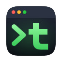
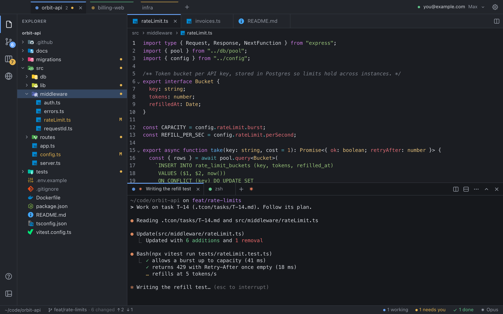
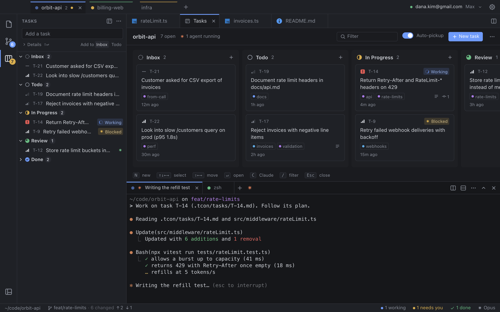
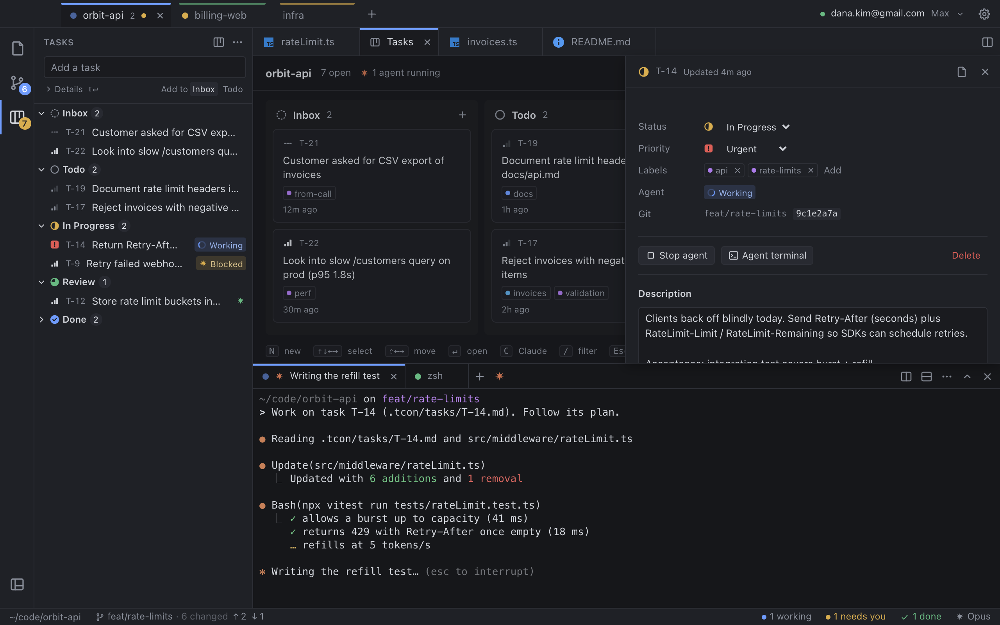
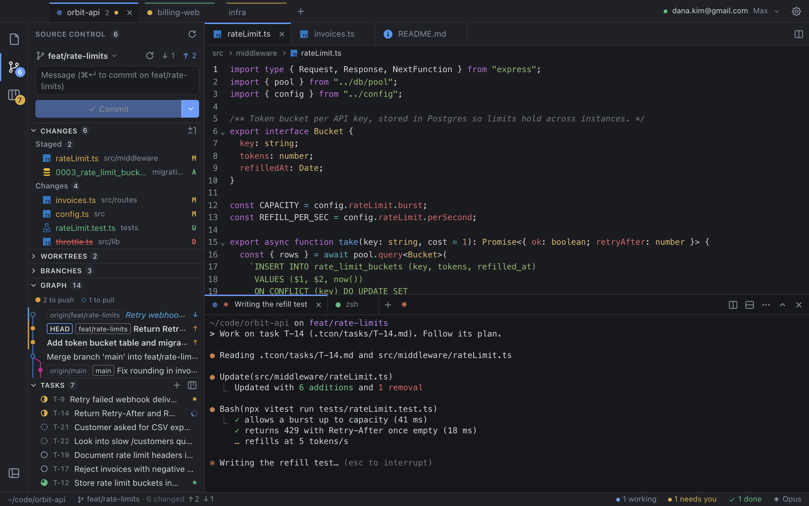
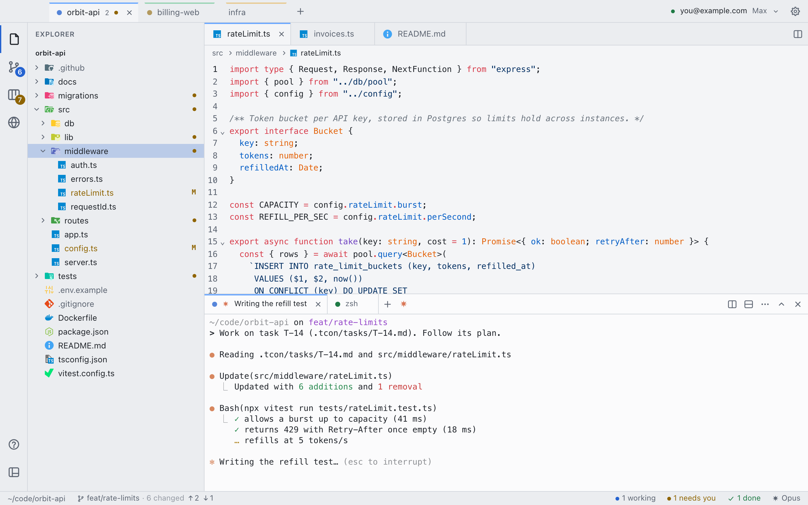

<p align="center">
  
</p>

<h1 align="center">tCon</h1>

<p align="center">
  <b>The workspace for running Claude Code: many projects, many sessions, one window.</b><br>
  Terminal tabs and splits, an editor, git, a task board that Claude works through for you,<br>
  and instant switching between Claude accounts.
</p>

<p align="center">
  <a href="https://github.com/Tomkoooo/tCon/releases/latest"></a>
  <a href="https://github.com/Tomkoooo/tCon/actions/workflows/ci.yml"></a>
  <a href="LICENSE"></a>
  <a href="https://github.com/Tomkoooo/tCon/stargazers"></a>
</p>

<p align="center">
  
</p>

---

## Why tCon

When Claude Code does the typing, your job shifts. You watch several sessions, notice the one that's
waiting for you, review diffs, commit, and hand out the next task. A plain terminal isn't built for that,
and a full IDE is overkill. tCon sits in between:

- **See every session at a glance.** Each Claude session reports whether it's *working*,
  *needs you* or *done*, on its tab, in the status bar and on the Dock badge. Press **⌘J** to
  jump straight to whichever one needs you.
- **Turn meeting notes into shipped commits.** Type issues into the task board while people talk.
  Then click *Let Claude work on this*: it reads the task, plans, implements, runs your tests,
  commits, and moves the card along as it goes.
- **Switch Claude accounts without logging in again.** Work and personal, or two Max plans:
  each account keeps its own saved login, and switching takes one click.
- **Feels like VS Code.** It uses your VS Code color themes, icon themes, `settings.json` and
  `keybindings.json`, with editor groups, terminal splits and a git graph.

It's a native app built with Tauri and Rust, so it starts fast and uses little memory.

## Features

### Projects and terminals
- Projects open as tabs. Each one has its own terminals, editors, layout and colour, and is restored on relaunch.
- Terminal tabs with horizontal and vertical splits. The panel can sit at the bottom or the side, or be maximized. GPU rendering through xterm.js WebGL.
- One-key Claude sessions: **⇧⌘C** starts `claude` in the current project.
- Live session status, parsed from the terminal: working / needs you / done / error, plus a desktop notification when a hidden session needs you.
- Model choice: set a default Claude model (Opus, Sonnet, Haiku or any model ID) and override it per project.

### Task board with Claude agents


- A Trello-style board for each workspace, with Inbox → Todo → In Progress → Review → Done columns and drag-and-drop.
- **Quick capture (⇧⌘A):** type a line and press Enter. It's built for writing down issues during a meeting.
- **Let Claude work on this:** starts a Claude Code agent in its own terminal. The agent follows the task protocol: read the task, check the code, write a plan, implement, verify, commit, and update the card.
- Cards show the agent's live state (Working, Needs you, Blocked, Failed), its plan, progress log, verification results and commits.
- **Auto-pickup:** when a task lands in Todo, tCon can ask whether an agent should take it, with a limit on how many agents run at once and a queue for the rest.
- **Plain files:** tasks are Markdown in `.tcon/tasks/`. They're kept out of git by default; share the board through git with one toggle.
- **Global skill:** one click installs the `tcon-tasks` skill into Claude Code, so any Claude session can find and work tasks, even outside tCon.



### Editor
- A CodeMirror 6 editor with editor groups, splits, preview tabs and pinned tabs.
- Markdown edit / split / preview.
- **Tracks changes made outside tCon.** When Claude, another editor or a formatter rewrites a file, it reloads, or asks first if you have unsaved edits. There's also a refresh on window focus and on **⇧⌘R**.

### Browser with memory
- **Built-in pages** open as editor tabs next to your code, with back/forward, an address bar and Web Inspector. Logins and cookies survive restarts, kept in their own store, and can be cleared any time.
- **tCon Chrome:** real Chrome with its own persistent tCon profile, controlled from the sidebar. It has Chrome DevTools and extensions, including Claude in Chrome, so Claude Code can open your app and test it.
- **Dev servers are detected automatically** from terminal output, e.g. `Local: http://localhost:5173`; one click opens them.
- **Import your sessions** from an existing Chrome, Brave, Edge or Chromium profile.
- A "Use with Claude" helper gives you the `chrome-devtools-mcp` setup for the tCon Chrome profile.

### Git


- Stage and unstage files, discard changes, commit, amend, commit & push, fetch, pull, publish, stash.
- Branches and worktrees, with checkout on double-click.
- A commit graph colored by sync state: what's still to push, what's to pull, and what's only on unpushed branches. Author and date are in the tooltip, so the messages get the full width.
- Diff view for staged and working-tree changes. Git decorations in the file tree.

### Claude accounts
- Add as many Claude Code accounts as you like. Each gets its own `CLAUDE_CONFIG_DIR` and its own saved login.
- The header shows which account you're on and its plan. Switching applies to new sessions, and tCon offers to restart idle ones on the new account.
- Settings, `CLAUDE.md`, commands, agents, skills, plugins and project history are shared across accounts; only the login is separate.

### Make it yours


- **VS Code themes:** tCon finds the color and icon themes you have installed in VS Code, Cursor, VSCodium and Windsurf. You can also drop themes into `~/.tcon/themes`.
- Light, dark, or follow the system.
- Config files in `~/.tcon/`: `settings.json`, `keybindings.json` (VS Code syntax, including `-command` removal and `when` clauses), and `custom.css`. They all reload live.
- Custom app icon: pick a built-in variant (Default, Classic, Light, Graphite) or use your own image.



### Security
- Settings → Security audits each Claude account: where the login lives (Keychain or a plaintext file), file permissions, and credential files shared between accounts. One click fixes the permissions.
- A strict CSP. Only tCon's own UI can call its internal commands; browser pages and other content can't, and file commands refuse credential and `~/.ssh` paths.
- Signed macOS builds use the hardened runtime. CI installs dependencies without install scripts and runs `npm audit` and `cargo audit`.
- See [SECURITY.md](SECURITY.md) for the honest threat model.

## Download

Get the latest build from **[Releases](https://github.com/Tomkoooo/tCon/releases/latest)**:

| Platform | File |
| --- | --- |
| macOS, Apple Silicon | `tCon_*_aarch64.dmg` |
| macOS, Intel | `tCon_*_x64.dmg` |
| Linux | `.AppImage`, `.deb` or `.rpm` |

Windows support is planned; the PTY and shell setup still need porting.

> **macOS:** the builds aren't notarized yet. On first launch, right-click the app and choose **Open**, or run
> `xattr -dr com.apple.quarantine /Applications/tCon.app`.

**Requirements:** [Claude Code](https://docs.claude.com/en/docs/claude-code) (`claude`) on your `PATH`, and `git`.

## Keyboard shortcuts

| Action | Shortcut |
| --- | --- |
| Open project | ⌘T |
| Jump to the session that needs you | ⌘J |
| New Claude session / new terminal | ⇧⌘C / ⇧⌘T |
| Split terminal right / down | ⌘D / ⇧⌘D |
| Toggle panel / maximize panel | ⌃\` / ⇧⌘M |
| Toggle sidebar · Explorer · Source Control | ⌘B · ⇧⌘E · ⇧⌘G |
| Quick-add task · open task board | ⇧⌘A · ⇧⌘B |
| Open URL in the browser | ⇧⌘O |
| Refresh files and git status | ⇧⌘R |
| Settings | ⌘, |

To change any of these, edit `~/.tcon/keybindings.json`.

## How it works

```
┌──────────────────────── React + TypeScript (Vite) ────────────────────────┐
│ workbench · CodeMirror editor · xterm.js terminals · git panel · board    │
│ zustand stores · VS Code theme engine (tokens, syntax, icon themes)       │
└───────────────▲──────────────────────────────────────────▲────────────────┘
                │ Tauri commands / events                  │ PTY data channel
┌───────────────┴────────────────────── Rust (Tauri 2) ─────┴───────────────┐
│ pty.rs     portable-pty sessions, login-shell env                         │
│ osc.rs     parses OSC 7501 status sequences → working / blocked / done    │
│ git.rs     libgit2 + git CLI: status, log graph, ops                      │
│ fs.rs      file IO, debounced recursive watcher (notify) with rescan      │
│ tasks.rs   .tcon/tasks/*.md frontmatter store, atomic writes              │
│ cli.rs     claude auth status/login/logout per CLAUDE_CONFIG_DIR          │
│ themes.rs  discovers VS Code / Cursor / VSCodium / Windsurf extensions    │
│ db.rs      SQLite: workspace snapshot, recents, settings                  │
└───────────────────────────────────────────────────────────────────────────┘
```

- **Session status.** Claude Code emits a status escape sequence (OSC 7501) in its terminal output; tCon strips it from the stream and turns it into tab/Dock state, so it needs no plugins or API keys.
- **Accounts.** Each account sets `CLAUDE_CONFIG_DIR`, which Claude Code uses to keep its login separate. Shared items (settings, `CLAUDE.md`, commands, agents, skills, plugins, project history) are symlinked from `~/.claude`.
- **Tasks.** Each task is one Markdown file with YAML frontmatter. Claude edits it with its normal file tools, and tCon's file watcher updates the board live. The protocol lives in [`src-tauri/resources/tcon-tasks/SKILL.md`](src-tauri/resources/tcon-tasks/SKILL.md).

## Build from source

```bash
# prerequisites: Node 22+, Rust stable, and Tauri's platform dependencies
# (https://tauri.app/start/prerequisites/)
git clone https://github.com/Tomkoooo/tCon.git
cd tCon
npm install
npm run tauri dev        # run in development
npm run tauri build      # produce a release bundle
```

Checks that run in CI:

```bash
npx tsc --noEmit
cd src-tauri && cargo test
```

## Releases

Every push to `main` runs [`release.yml`](.github/workflows/release.yml). If the version in
`src-tauri/tauri.conf.json` doesn't have a release yet, it builds macOS (arm64 and x64) and Linux
bundles and publishes them as `v<version>`. So bump the version to ship. Pull requests and branches run
[`ci.yml`](.github/workflows/ci.yml): typecheck, frontend build, `cargo test` and clippy.

## Roadmap

- Windows support
- Plugin API with a GitHub template and install from GitHub
- Custom board columns and per-task git worktrees for parallel agents
- Notarized macOS builds and auto-update

## Contributing

Contributions are welcome. Read [CONTRIBUTING.md](CONTRIBUTING.md), open an issue for bigger changes,
and send a PR. If tCon saves you time, a ⭐ helps other people find it.

## License

[MIT](LICENSE) © 2026 Tomkoooo and tCon contributors
