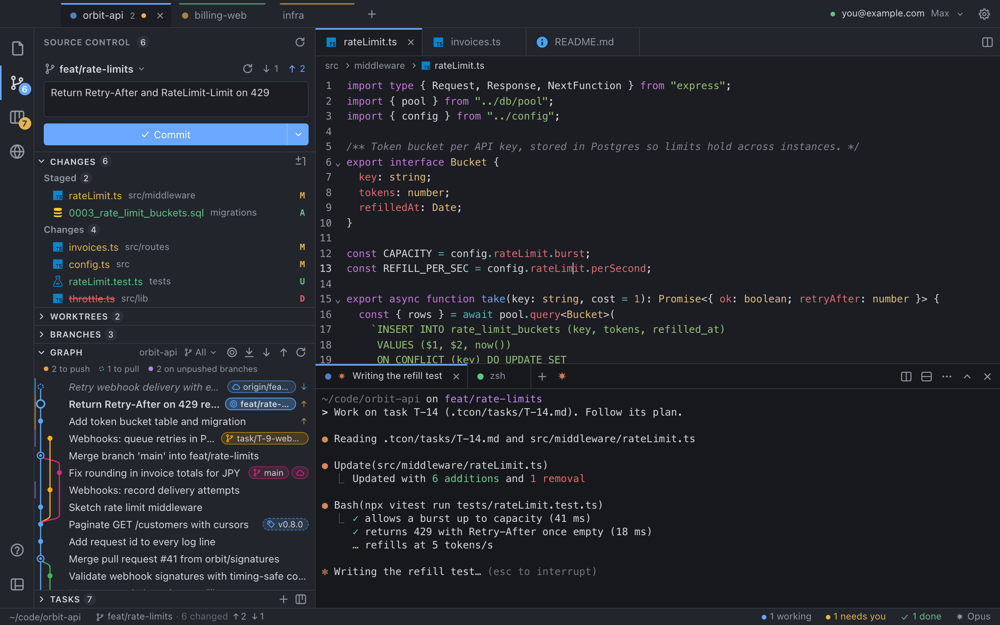
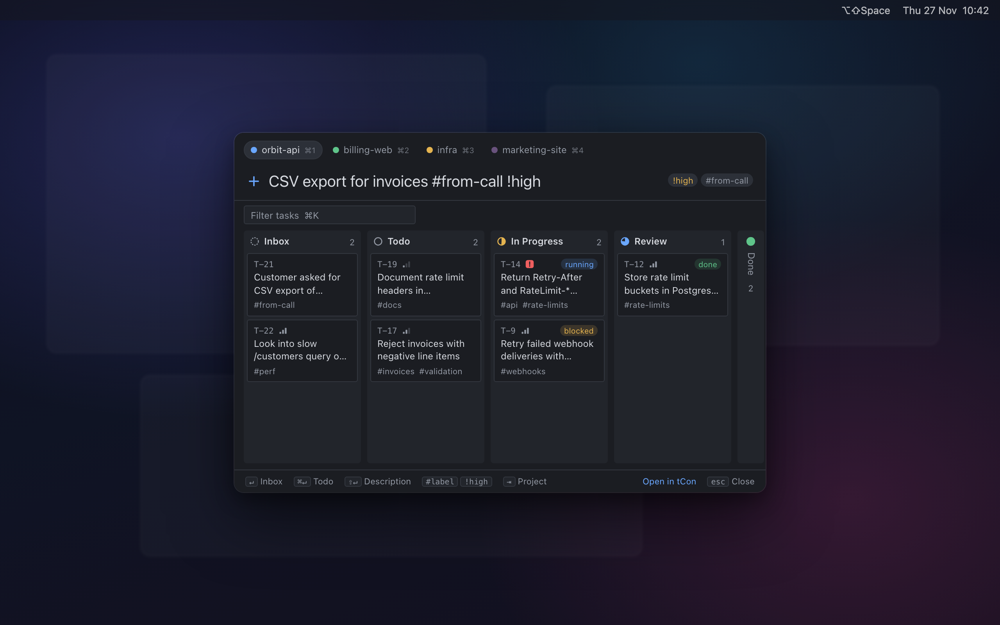
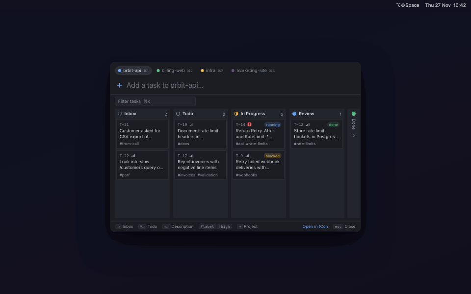
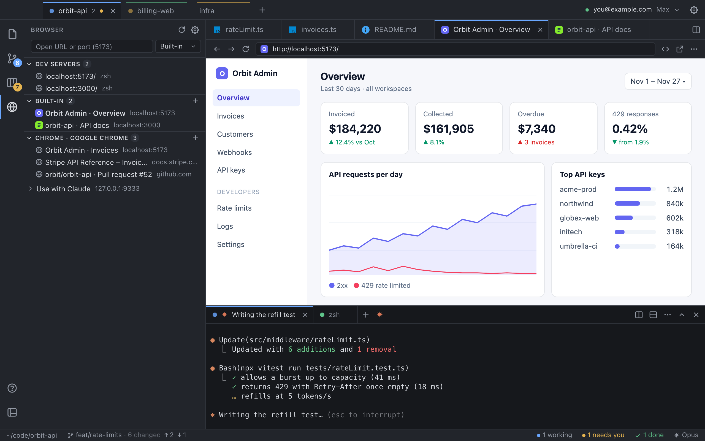
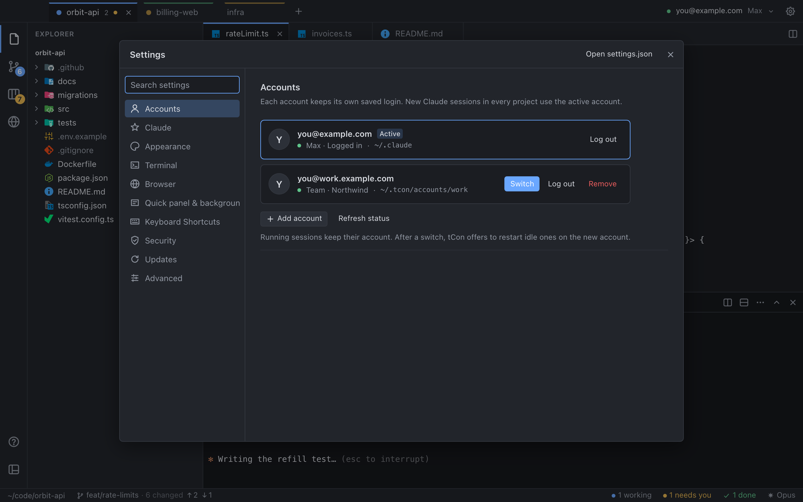

<p align="center">
  
</p>

<h1 align="center">tCon</h1>

<p align="center">
  A desktop workspace for running Claude Code across many projects at once.
</p>

<p align="center">
  <a href="https://github.com/Tomkoooo/tCon/releases/latest"></a>
  <a href="https://github.com/Tomkoooo/tCon/actions/workflows/ci.yml"></a>
  <a href="LICENSE"></a>
</p>

<p align="center">
  
</p>

tCon puts each project in a tab with its own terminals, editor, git panel and task board. Claude Code
sessions report whether they are working, waiting for you or done, so you can run several of them and
only switch when one needs you. It is built with Tauri and Rust and uses your existing VS Code themes
and keybindings.

> **Status: alpha.** tCon is developed on macOS and is new. Expect rough edges. Linux builds are
> published but less tested, and Windows isn't supported yet. Bug reports are very welcome.

## Install

Download the latest build from [Releases](https://github.com/Tomkoooo/tCon/releases/latest):

| Platform | File |
| --- | --- |
| macOS, Apple Silicon | `tCon_<version>_aarch64.dmg` |
| macOS, Intel | `tCon_<version>_x64.dmg` |
| Linux (x86_64) | `.AppImage`, `.deb` or `.rpm` |

The macOS builds are not notarized yet. On first launch, right-click the app and choose **Open**, or run:

```bash
xattr -dr com.apple.quarantine /Applications/tCon.app
```

**Requirements:** [Claude Code](https://docs.claude.com/en/docs/claude-code) (`claude` on your `PATH`) and `git`.
tCon updates itself from GitHub Releases after that.

## Getting started

1. **Open a project** with **⌘T** and pick a folder. It opens as a tab and is restored next launch.
2. **Start Claude** with **⇧⌘C**. The tab shows the session state; **⌘J** jumps to whichever session needs you.
3. **Add accounts** (optional) from the account menu in the top-right. Each Claude account keeps its own login, so switching is one click.
4. **Capture tasks** with **⇧⌘A**, or press **⌥⇧Space** from any app to open the quick panel.
5. **Hand a task to Claude**: open the board (**⇧⌘B**), select a card, and choose **Let Claude work on this**.

Press **F1** inside tCon for the full feature reference.

## Features

### Projects, terminals and Claude sessions

- Project tabs with their own terminals, editors, layout and colour, restored on relaunch.
- Terminal tabs with splits; the panel docks at the bottom or side and can be maximized.
- Session status (working, needs you, done, error) from Claude Code's status escape sequence, shown
  on tabs, in the status bar, on the Dock badge and as notifications for hidden sessions.
- A default Claude model (Opus, Sonnet, Haiku or any model ID), with per-project overrides.

### Task board and agents


Each project has a kanban board. Tasks are plain Markdown files in `.tcon/tasks/`, kept out of git
unless you choose to share them.

- **Let Claude work on this** starts Claude Code in its own terminal. It reads the task, writes a
  plan, implements, runs your checks, commits, and updates the card's status and log as it goes.
- **Auto-pickup** can ask whether to start an agent when a task reaches Todo, with a limit on
  concurrent agents and a queue.
- A one-click install adds the `tcon-tasks` skill to Claude Code, so sessions outside tCon follow
  the same protocol.

### Quick panel



tCon keeps running in the menu bar after you close the window. **⌥⇧Space** opens a floating panel
from any app: pick a project, type a task, press Enter. `#label` and `!high` are parsed from the
title. Optionally launch at login so the shortcut always works.



### Git


- Stage, discard, commit, amend, push, pull, fetch, stash, branches and worktrees.
- A commit graph in the style of VS Code. Rows are coloured by sync state (to push, to pull, on
  unpushed branches).
- Hovering a commit opens a card with the full message and changed-file stats. It has buttons to
  copy the hash, open the commit on GitHub, check it out, or branch from it.

### Browser



- **Built-in tabs** open in the editor area with Web Inspector. Cookies and logins persist across
  restarts in their own store.
- **tCon Chrome** launches your installed Chrome with a dedicated profile that tCon controls from
  the sidebar. Chrome DevTools and extensions work there, including Claude in Chrome. You can
  import an existing Chrome, Brave, Edge or Chromium profile.
- Dev-server URLs printed in your terminals (`Local: http://localhost:5173`) are listed automatically.

### Editor

- CodeMirror 6 with editor groups, splits, preview and pinned tabs, and Markdown preview.
- Files changed by other programs reload automatically, or prompt first if you have unsaved edits.

### Accounts, settings and themes



- Several Claude Code accounts, each in its own `CLAUDE_CONFIG_DIR`, sharing settings, skills and
  history. Only the login is separate.
- VS Code, Cursor, VSCodium and Windsurf color and icon themes are picked up automatically.
- `~/.tcon/settings.json`, `keybindings.json` (VS Code syntax) and `custom.css`, all reloaded live.
- A custom app icon, either one of the built-in variants or your own image.

## Keyboard shortcuts

| Action | Shortcut |
| --- | --- |
| Open project | ⌘T |
| New Claude session / terminal | ⇧⌘C / ⇧⌘T |
| Jump to the session that needs you | ⌘J |
| Split terminal right / down | ⌘D / ⇧⌘D |
| Toggle panel / sidebar | ⌃\` / ⌘B |
| Explorer / Source Control | ⇧⌘E / ⇧⌘G |
| Quick-add task / task board | ⇧⌘A / ⇧⌘B |
| Quick panel (global) | ⌥⇧Space |
| Open URL in the browser | ⇧⌘O |
| Refresh files and git status | ⇧⌘R |
| Help / Settings | F1 / ⌘, |

All bindings can be changed in `~/.tcon/keybindings.json`; the Help page lists the effective ones.

## Security

tCon does not store Claude credentials; Claude Code keeps them in the macOS Keychain (or a file on
Linux). Settings → Security audits each account's credential location and file permissions and can
fix loose permissions. The app limits its internal commands to its own UI, runs with a strict CSP,
and signed builds use the macOS hardened runtime.

Anything that runs as your user, such as an npm install script, can read the same credentials
Claude Code reads. [SECURITY.md](SECURITY.md) explains the threat model and how to report a vulnerability.

## Known limitations

- Windows is not supported yet: the PTY shell setup and PATH lookup are Unix-only.
- macOS builds are unsigned and not notarized until a Developer ID is set up.
- Built-in browser tabs use the system WebView (WebKit on macOS), so Chrome extensions only work in tCon Chrome, which runs as a separate window.
- Safari and Firefox sessions can't be imported.
- On Linux, the global shortcut and tray icon need X11; Wayland compositors block global shortcuts.

## How it works

The UI is React and TypeScript (CodeMirror, xterm.js, zustand). The backend is Rust on Tauri 2:

| Module | Responsibility |
| --- | --- |
| `pty.rs`, `osc.rs` | Terminal sessions; parsing Claude Code's OSC 7501 status sequence |
| `git.rs` | Status, log graph and git operations (libgit2 plus the git CLI) |
| `fs.rs` | File I/O and a debounced recursive watcher |
| `tasks.rs` | The `.tcon/tasks/*.md` store with atomic writes |
| `cli.rs`, `security.rs` | Claude account login/logout and credential audits |
| `browser/` | Built-in webviews and Chrome control over the DevTools protocol |
| `background.rs` | Tray, global shortcut and the quick panel window |
| `themes.rs`, `db.rs` | VS Code theme discovery; SQLite for workspace state |

## Development

Prerequisites: Node 22+, Rust stable, and [Tauri's platform dependencies](https://tauri.app/start/prerequisites/).

```bash
git clone https://github.com/Tomkoooo/tCon.git
cd tCon
npm install
npm run tauri dev
```

Checks run in CI on every branch and pull request:

```bash
npx tsc --noEmit
npm test
cd src-tauri && cargo test
```

### Releases

Versions follow SemVer, with pre-1.0 alphas such as `0.1.0-alpha.1`. To release, run
`npm run version:bump -- alpha` (or `patch`, `minor`, or an explicit version), fill in
[CHANGELOG.md](CHANGELOG.md), and push to `main`. [`release.yml`](.github/workflows/release.yml) then
builds macOS and Linux bundles with signed update packages, publishes the release with its changelog section, and
installed copies pick it up through the updater. See [CLAUDE.md](CLAUDE.md#releasing) for details.

## Roadmap

- Windows support
- A plugin API, with a GitHub template and install-from-GitHub
- Custom board columns and a git worktree per task for parallel agents
- Notarized macOS builds

## Contributing

Issues and pull requests are welcome. [CONTRIBUTING.md](CONTRIBUTING.md) covers setup and
conventions, and [CLAUDE.md](CLAUDE.md) holds the rules AI agents follow in this repo.

## License

[MIT](LICENSE)
